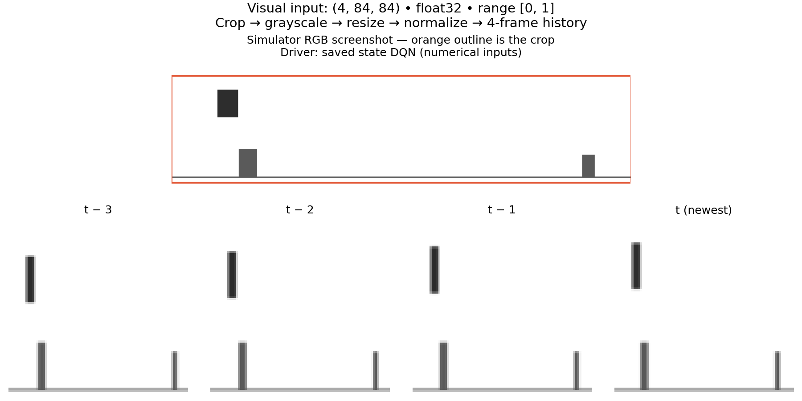
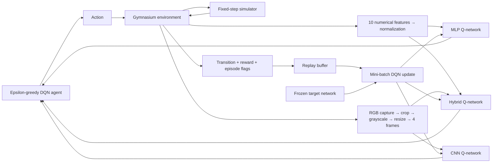
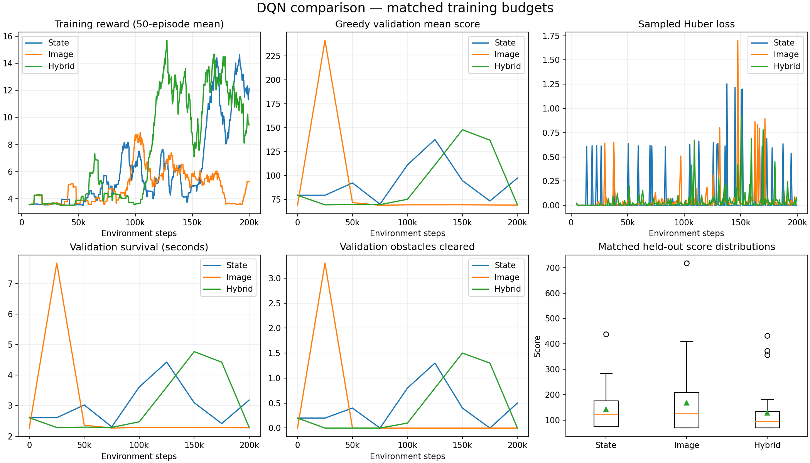
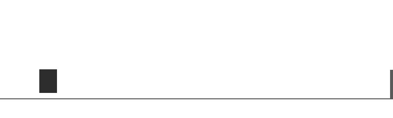
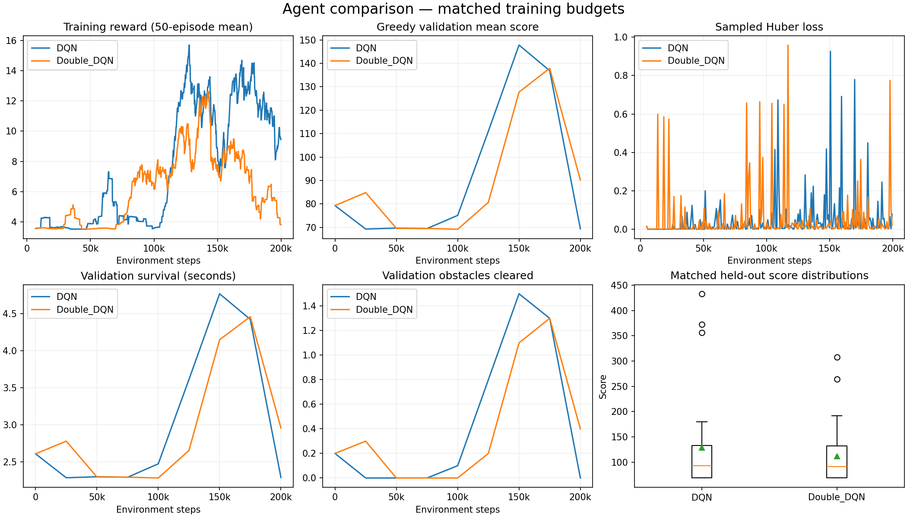

# Dino RL

A Python and PyTorch project for learning reinforcement learning by teaching an
agent to play Dino. **Current scope: Milestones 1–7: state, image and hybrid DQN/Double DQN, a reproducible simulator,
checkpoints, evaluation, TensorBoard, and visual observation preprocessing.**
Chrome integration remains a later milestone.

The simulator is original, lightweight code with no browser dependency. State-only headless
steps use numerical physics only; image agents capture simple rectangle graphics in memory.

## Setup

Python 3.10 or newer is required. From the repository root:

```bash
python3 -m venv .venv
source .venv/bin/activate
python -m pip install -r requirements.txt
python -m pytest
```

`requirements.txt` installs the editable package, test tools, and optional Pygame
display. For headless use alone: `python -m pip install -e .`. Dependencies are
declared in `pyproject.toml`; supported ranges are not an exact cross-platform
lockfile. PyTorch runs the neural network and its learning updates.
The simulator itself always runs on CPU, including when MPS or CUDA is selected.

## Run a random agent

```bash
python scripts/play_simulator.py --episodes 10 --seed 42
python scripts/play_simulator.py --episodes 3 --render
python scripts/play_simulator.py --config configs/environment.yaml \
  --episodes 10 --seed 42 --output results/random_seed42.json
```

The display runs at the configured FPS. Headless state-based play has no sleep or
image allocation. Visual observations do render into memory but need no desktop
window. Close the window or press Ctrl+C to stop. Output includes each
episode's reward, distance-based score, simulated survival time, obstacle count,
and termination reason. JSON output also records resolved configuration and seed.

## Train state-based DQN

```bash
python scripts/train.py --algorithm dqn --observation state --steps 12000 --device cpu
python scripts/train.py --config configs/state_dqn.yaml --steps 500000 \
  --seed 42 --experiment state_dqn
```

The first command is a short execution check, not enough evidence of skilled play.
`--episodes 50` optionally stops after 50 completed episodes or the step budget,
whichever comes first. Use `--render` to display training; it slows simulation to
real time. `--device auto` selects CUDA, then MPS, then CPU. For this tiny MLP,
CPU is a useful starting point; no accelerator speed advantage is assumed.

Each run creates a fresh directory beneath `runs/<experiment>/`, containing:

- `config.json`: full resolved configuration, seed, device, scaling and library versions.
- `episodes.csv`: completed-episode rewards, scores, length, survival, cleared obstacles,
  epsilon and ending reasons.
- `updates.csv`: first update and every 100th update by default, with loss, mean chosen-action
  Q-value, mean target, epsilon and replay size. These are sampled update values, not averages.
- `summary.json`: counts, final update metrics, weight-change check and any unfinished episode.
- `evaluations.csv` and `evaluation_<step>.json`: greedy validation summaries and episode data.
- `tensorboard/`: live scalar events for the browser dashboard.
- `checkpoints/`: `latest.pt`, `best.pt`, and periodic `step_<step>.pt` snapshots.

Use `--output-dir <new-directory>` to choose the exact destination. Existing directories
are rejected. Checkpoints include online/target weights, Adam state, step/episode
counts, epsilon, configuration, replay memory, the unfinished game and RNG states.
Files are replaced atomically after a successful write. Snapshots include the full
replay buffer: state snapshots are about 10 MB, while full image snapshots are
about 720 MB (including optimizer/model tensors). The image profile retains the last
two periodic snapshots plus best/latest; `keep_periodic_checkpoints: 0` retains all.
Allow several GB of disk space for an image run. Format-v1 state checkpoints still load;
new format-v2 checkpoints also preserve visual frame history and paired hybrid replay.

## Watch and monitor training

Run this in a second terminal with the same virtual environment active:

```bash
tensorboard --logdir runs --host 127.0.0.1 --port 6006
```

Open [TensorBoard](http://127.0.0.1:6006) and use Scalars to see:

- `episodes/`: exploratory training reward, score, survival time and obstacles cleared.
- `updates/`: loss, average chosen-action Q-value, exploration and replay size.
- `evaluations/`: greedy mean score, score spread, survival and obstacle counts.

The greedy evaluation charts are the clearest indication of playing ability;
training scores also reflect intentionally random actions, and falling loss alone
does not establish good gameplay. Events flush every five seconds. Training
evaluation defaults to every 25,000 steps, using ten fixed validation seeds starting
at 10,000. The initial model and final step are also evaluated. Lower frequencies
in the config mean more frequent checks, with more overhead.

Watch a saved agent without exploration or learning:

```bash
python scripts/evaluate.py --checkpoint runs/YOUR_RUN/checkpoints/best.pt \
  --episodes 3 --render --output results/watch.json
```

Use `python scripts/train.py --steps 12000 --render` to watch training itself.
Rendering runs in real time; headless training is much faster. Closing the window
or pressing Ctrl+C retains the last completed checkpoint, rather than trying to
save a potentially half-applied optimizer update.

## Evaluate and resume

```bash
python scripts/evaluate.py --checkpoint runs/YOUR_RUN/checkpoints/best.pt \
  --episodes 30 --seed 20000 --compare-random --output results/heldout.json

python scripts/train.py --resume runs/YOUR_RUN/checkpoints/latest.pt \
  --steps 750000 --device cpu --experiment state_dqn_resumed

python scripts/plot_training.py --run runs/YOUR_RUN \
  --comparison results/heldout.json --output results/training.png

python scripts/record_gameplay.py --checkpoint runs/YOUR_RUN/checkpoints/best.pt \
  --seed 20000 --seconds 12 --output results/gameplay.gif
```

`--steps` and `--episodes` on resume are **total budgets**, including previous work.
Saved simulator/reward/DQN settings and the training seed are retained; changing
them is rejected. The runtime device may change, but bitwise equivalence is only
tested for CPU resume on the same software stack. Resume logs go to a new segment
with cumulative step numbers; select both runs in TensorBoard to view the history.
`best.pt` is selected by highest mean validation score within that segment,
including its initial evaluation; ties retain the earlier checkpoint.

Evaluation uses epsilon=0, no learning, and its own environment. `--compare-random`
runs a uniform random baseline on the same episode seeds. Reports contain every
episode, means, maximum score, population standard deviation, simulated survival,
reward, obstacles and truncation counts, plus checkpoint hash and configuration.
Use held-out seeds such as 20,000–20,029 for the final comparison, separate from
the seeds that selected `best.pt`. Time-limit survivals are capped, not crashes.
Output files are not overwritten. Load only checkpoints you trust; loading uses
PyTorch's `weights_only=True` format with tensors and primitive values.

### How the learning loop works

1. Scale the game's ten numerical features into comparable ranges.
2. Choose a random action with probability epsilon, otherwise take the largest Q-value.
3. Store `(state, action, reward, next_state, terminated)` in a 100,000-entry ring buffer.
4. Once 5,000 transitions have been collected, sample 64 experiences per update.
5. Update the online MLP using Adam and Huber loss against these vanilla DQN targets:

```text
crash:     target = reward
otherwise: target = reward + 0.99 * max(Q_target(next_state))
network:   10 → Linear(128) → ReLU → Linear(128) → ReLU → Linear(3)
```

The target network starts as a separate frozen copy, then synchronizes after each
5,000 environment steps. Epsilon decreases linearly from 1.0 to 0.05 over 200,000
environment steps, including warm-up. Updates default to every step after warm-up;
`train_frequency` makes this configurable. An update also requires at least one full
batch, even if `learning_starts` is configured smaller than `batch_size`.
All settings live in `configs/state_dqn.yaml` and validated configuration objects.

The implementation uses the standard DQN ingredients described in the
[PyTorch DQN tutorial](https://docs.pytorch.org/tutorials/intermediate/reinforcement_q_learning),
with Adam and hard target synchronization as specified for this project. A time
limit resets the episode but **does not** remove future value from its target;
see [Gymnasium's time-limit guidance](https://gymnasium.farama.org/main/tutorials/handling_time_limits/).
The final pre-reset observation is stored in replay. Greedy action selection is
available with `agent.act(state, epsilon=0)` and the standalone evaluation script.

## Visual observations

The image pipeline feeds the CNN. Its output is a
`float32` array shaped **`(4, 84, 84)`**, with pixels in **[0, 1]**, ordered oldest
to newest. Add a batch dimension to obtain PyTorch's `(N, C, H, W)` format.

```python
import torch
from dino_rl.config import load_config
from dino_rl.envs import DinoEnv, ImageObservationWrapper

config = load_config("configs/image_observation.yaml")
env = ImageObservationWrapper(
    DinoEnv(config.simulator, config.rewards, render_mode="rgb_array"), config.image
)
try:
    obs, info = env.reset(seed=42)
    obs, reward, terminated, truncated, info = env.step(1)
    batch = torch.from_numpy(obs).unsqueeze(0)  # (1, 4, 84, 84)
finally:
    env.close()
```

Pipeline: RGB screenshot → gameplay crop → grayscale luminance → bilinear resize
to 84×84 → normalized four-frame stack. Configuration is in
`configs/image_observation.yaml`. The default crop is `(0, 24, 800, 210)`, using
left/top/right/bottom coordinates with exclusive right and bottom bounds. It
retains all horizontal lookahead and the default jump arc while removing unused
vertical margins. `crop: null` keeps the entire frame. Change the crop when using
different camera geometry or jump physics; invalid/out-of-frame crops fail clearly.

`ImagePreprocessor` accepts **uint8 RGB arrays** and has no simulator dependency.
It can later be reused with screenshots. BGR/BGRA captures need explicit conversion
before entry. `process_uint8()` returns compact 84×84 pixels; calling the processor
directly returns one normalized float32 frame. Grayscale conversion and resampling
use [Pillow](https://pillow.readthedocs.io/en/stable/reference/Image.html).

The stack holds compact uint8 frames internally, normalizing fresh outputs without
exposing mutable internal arrays. On reset all four channels repeat the new initial
frame, following the [reset-padding convention](https://gymnasium.farama.org/api/wrappers/observation_wrappers/).
Every environment step adds one frame. There is **no action repeat or frame skip**:
at 60 Hz, `t−3` through `t` span 50 ms. The crash/time-limit frame is returned before
reset, and reset clears the previous episode's history. Rewards, actions and physics
are unchanged. Numerical `info` fields remain for debugging, not as visual model inputs.

Create a preview with a random driver or the previously trained numerical agent:

```bash
python scripts/preview_observations.py --steps 500 --output-dir results/image_preview
python scripts/preview_observations.py \
  --checkpoint runs/milestone3_state_dqn/checkpoints/best.pt \
  --seed 42 --steps 135 --output-dir results/state_driven_image_preview
```

Each new output directory contains the raw RGB image, cropped grayscale image,
84×84 frame, normalized `stack.npy`, a labeled preview, and metadata including
configuration, actual shapes, driver identity and temporal pixel changes.
`--checkpoint` drives the game using **numerical state**; it does not turn that MLP
into a vision model. Use `--observation image` to train a separate CNN.



## Train image DQN (Milestone 5)

```bash
python scripts/train.py --algorithm dqn --observation image --steps 1000000
# Reproduce the smaller first experiment, with an explicit CPU budget:
python scripts/train.py --config configs/experiments/image_dqn_milestone5.yaml \
  --experiment image_dqn_reproduction
```

The image agent receives **pixels only**, with the same three actions and rewards.
The shared DQN agent/trainer selects its network, environment and replay through
configuration; evaluation, checkpoint resume, recording and TensorBoard work for both.

```text
4 × 84 × 84
 → Conv(32, kernel 8, stride 4) → ReLU
 → Conv(64, kernel 4, stride 2) → ReLU
 → Conv(64, kernel 3, stride 1) → ReLU
 → Flatten(3136) → Linear(256) → ReLU → Linear(3 Q-values)
```

Visual replay stores **five uint8 frames per transition**: four current frames
plus the newest next frame. Sampling reconstructs the next stack by shifting;
frames are converted to float32 [0, 1] only for network input. Each transition owns
its frames, avoiding references to overwritten history or another episode.
The 20,000-entry profile uses **705,860,000 bytes (673 MiB)** for replay arrays.
The memory guard rejects allocations above `replay_memory_limit_mb` before allocation.
By comparison, 100,000 pairs of float32 stacks would require **22.58 GB**.

The default image profile uses batch 32 and one update every four environment
steps. The bounded first experiment uses 200,000 steps, batch 16, one update every
eight steps, and epsilon decay over 100,000 steps. Both retain 5,000-step warm-up
and target synchronization, Adam at 1e-4 and Huber loss. **These budgets differ
from the state baseline; the comparison does not isolate architecture alone.**
There is no frame skipping or action repetition in either experiment.

`--device auto` supports CUDA/MPS/CPU. Benchmark both inference and updates on your
machine: on this M1 Pro, MPS was faster for batches but slower for individual
inferences. The recorded first image experiment uses CPU with one PyTorch thread.

Compare matched evaluations and export six charts plus CSV/JSON:

```bash
python scripts/compare_experiments.py \
  --reports results/milestone3_heldout.json results/milestone5_heldout.json \
  --labels State Image \
  --runs runs/milestone3_state_dqn runs/milestone5_image_dqn \
  --output-dir results/state_image_comparison
```

The script rejects different simulator settings, rewards or episode seeds. Graphs
show training reward, validation score, loss, survival, obstacles and held-out score
distributions. Do not interpret episode variation as independent training-seed evidence.

## Hybrid DQN (Milestone 6)

The hybrid model sees both screenshots and numerical state from the **same game
tick**. It learns both branches together from scratch; it does not import the
previous state or image model's weights.

```text
4 × 84 × 84 frames → Atari CNN → Linear(256) → ReLU ─┐
                                                   ├→ Concatenate(320)
10 normalized numbers → Linear(64) → ReLU ──────────┘
 → Linear(256) → ReLU → Linear(3 Q-values)
```

`HybridObservationWrapper` returns a Gymnasium Dict with `image` (`float32`,
4×84×84, [0,1]) and `state` (`float32`, 10 features). It normalizes numerical
features once using the same scales as the state agent. The trainer and evaluator
pass this dict directly to the hybrid network. Reset and terminal observations
keep both inputs synchronized; there is still one physics tick per action.

Hybrid replay extends compact image replay with current/next numerical vectors,
using one ring position and one set of sampled indices for both inputs. At 20,000
entries it needs **707,460,000 bytes (674.69 MiB)**: only 1.6 MB more than image
replay. The memory guard includes both inputs. Checkpoints preserve both, and
resume restores the numerical state and frame stack of the unfinished episode.

```bash
python scripts/train.py --algorithm dqn --observation hybrid --steps 1000000
# Reproduce the bounded comparison experiment:
python scripts/train.py --config configs/experiments/hybrid_dqn_milestone6.yaml \
  --output-dir runs/hybrid_reproduction
python scripts/evaluate.py --checkpoint runs/hybrid_reproduction/checkpoints/best.pt \
  --episodes 30 --seed 20000 --device cpu --output results/hybrid_reproduction.json
```

The default hybrid profile matches the default image training profile. Its state
branch width is configurable through `dqn.hybrid_state_hidden_size` (default 64);
`dqn.cnn_hidden_size` sets the image feature and fusion layer widths (default 256).
Evaluation, GIF recording, human rendering and TensorBoard use the shared scripts.
A hybrid policy **requires numerical inputs during inference**; it cannot be used
as a screenshot-only Chrome policy without a separate numerical-state adapter.

The Milestone 6 comparison uses 200,000 steps and 24,376 updates for **all three**
models, with the same batch size 16, replay capacity 20,000, update frequency 8,
seed 42, exploration schedule, physics, rewards and validation/evaluation seeds.
A fresh matched-budget state run is compared with the saved image run and the new
hybrid run. The original 500,000-step state result remains a separate reference.
These are one-seed experiments, not proof that any architecture consistently wins.

```bash
python scripts/compare_experiments.py \
  --reports results/milestone6_state_matched_heldout.json \
    results/milestone5_heldout.json results/milestone6_heldout.json \
  --labels State Image Hybrid \
  --runs runs/milestone6_state_matched runs/milestone5_image_dqn runs/milestone6_hybrid_dqn \
  --require-matched-training --output-dir results/milestone6_comparison
```

`--require-matched-training` checks training settings and completed step/update
budgets in addition to game settings and evaluation seeds. The three-run local
TensorBoard dashboard is available on port 6007 while its server is running.

## Double DQN (Milestone 7)

Vanilla DQN asks the target network both which next action looks best and what it
is worth. Double DQN uses the online network to choose, then reads that action's
value from the target network. It reuses the same two networks, optimizer, loss,
replay and hard synchronization; there is no third network.

```text
DQN:        next_value = max(Q_target(next_obs))
Double DQN: next_action = argmax(Q_online(next_obs))
            next_value = Q_target(next_obs)[next_action]
Both:       target = reward + gamma * next_value
Crash:      target = reward
```

For example, if online Q-values are `[2, 7, 4]` and target Q-values are `[8, 3, 6]`,
Double DQN chooses JUMP (index 1) from the online network and uses target value **3**.
Vanilla DQN uses the target maximum, **8**. The immediate reward is then added to
the discounted value; a crash uses only the immediate reward.

Time limits still bootstrap from the final observation. Both calculations run
without gradients. The change aims to reduce overestimation from maximizing noisy
value estimates, as described in [the original Double DQN paper](https://arxiv.org/abs/1509.06461).
It does not guarantee a higher game score, and our gameplay results do not directly
measure value-estimation bias.

```bash
python scripts/train.py --algorithm double_dqn --observation state --steps 500000
python scripts/train.py --algorithm double_dqn --observation image --steps 1000000
python scripts/train.py --algorithm double_dqn --observation hybrid --steps 1000000
# Hybrid Double DQN profile, or the bounded reproduction profile:
python scripts/train.py --config configs/double_dqn.yaml
python scripts/train.py --config configs/experiments/double_dqn_milestone7.yaml \
  --output-dir runs/double_reproduction
```

Without `--config`, the observation selects its existing `<observation>_dqn.yaml`
profile and `--algorithm` selects the target rule. An explicit algorithm overrides
the config; omission preserves the config's algorithm. With `--resume`, omission
preserves the saved algorithm, and changing algorithms is rejected. Old checkpoints
without the new config field default to DQN. Evaluation and recording automatically
use the saved algorithm and observation type.

The recorded comparison keeps the Milestone 6 hybrid architecture, initial weights,
seed 42, 200,000 environment steps, 24,376 updates, batch 16, 20,000 replay entries,
update frequency 8 and all other training settings. Only the algorithm differs.
The new Double DQN run starts from scratch, not from a trained DQN checkpoint.

```bash
python scripts/evaluate.py \
  --checkpoint runs/milestone7_hybrid_double_dqn/checkpoints/best.pt \
  --episodes 30 --seed 20000 --device cpu --compare-random \
  --output results/milestone7_heldout.json
python scripts/compare_experiments.py \
  --reports results/milestone6_heldout.json results/milestone7_heldout.json \
  --labels DQN Double_DQN \
  --runs runs/milestone6_hybrid_dqn runs/milestone7_hybrid_double_dqn \
  --require-matched-training --require-same-model \
  --output-dir results/milestone7_comparison
```

Both algorithms select checkpoints on validation seeds 10,000–10,009 and are tested
on the same 30 episode seeds 20,000–20,029. These test seeds have been reported in
prior milestones; no new tuning is based on their results. One training seed is
insufficient to establish a generally superior algorithm. The full million-step
Double DQN profile has not been run.

## Environment contract

```python
from dino_rl.envs import DinoEnv, Action

env = DinoEnv(render_mode=None)  # also "human" or "rgb_array"
obs, info = env.reset(seed=42)
env.action_space.seed(42)  # separate RNG for reproducible random actions
try:
    while True:
        obs, reward, terminated, truncated, info = env.step(Action.NO_ACTION)
        if terminated or truncated:
            break
finally:
    env.close()
```

This follows the [Gymnasium environment API](https://gymnasium.farama.org/api/env/):
crashes terminate an episode; the configurable step limit truncates it. Call
`reset()` before the first step and after either ending. DQN targets distinguish
true terminal states from time-limit truncations when bootstrapping.
`reset(seed=42)` repeats a world sequence; subsequent `reset()` calls continue its
local RNG stream. Global RNGs do not drive obstacle generation.

### Actions and physics

| ID | Action | Behavior for one simulation tick |
|---:|---|---|
| 0 | NO_ACTION | Release duck; continue flight if airborne |
| 1 | JUMP | Start a jump when grounded; ignored in flight |
| 2 | DUCK | Reduce grounded hitbox from 48 to 24 pixels; ignored in flight |

Jump held across landing starts another jump. Duck must be selected each tick to
remain active. Jump height and flight time follow configurable gravity and launch
velocity; there is no variable jump height or fast fall. Each step is 1/60 second
by default. Speed increases from 300 to 600 pixels/second. Obstacles spawn with
seeded gaps and sizes: ground cacti and birds 30 pixels above ground. Grounded duck
fits underneath a bird; standing collides. Axis-aligned rectangles define collision,
with swept horizontal bounds to reduce tunneling.

### Observations

The environment observation is **raw**, `float32`, shape `(10,)`. The training
pipeline applies `StateNormalizer` before the neural network and replay buffer.

| Index | Feature | Unit / meaning |
|---:|---|---|
| 0 | Game speed | pixels/second |
| 1 | Dino Y | pixels above ground |
| 2 | Vertical velocity | pixels/second; positive upward |
| 3 | Nearest unpassed obstacle distance | obstacle left minus Dino right; negative while overlapping |
| 4–5 | Obstacle width, height | pixels |
| 6 | Obstacle bottom | pixels above ground |
| 7 | Obstacle type | 0 none, 1 cactus, 2 bird |
| 8–9 | Jumping, ducking | 0 or 1 |

When no obstacle is available, distance is 800 and other obstacle fields are zero.
The observation space permits unbounded numerical values to accommodate configurable
physics. The nearest obstacle alone is a deliberately limited observation; future
training may benefit from additional obstacle lookahead. Full obstacles and speed
are accessible on `env.simulator` for debugging.

Normalization divides speed by configured maximum speed, Y by theoretical jump
height, velocity by launch speed plus one gravity tick, and distance by scene width.
Obstacle dimensions and bottom height use the standing Dino height; type uses 2;
flags stay unchanged. This is fixed scaling, not running statistics. Values are
roughly unit-sized, not strictly limited to [0, 1]. No clipping erases negative
distances or descending velocity. Scales are recorded with each run.

### Rewards and metrics

Defaults in `configs/environment.yaml`:

| Event | Reward |
|---|---:|
| Non-crash step | +0.1 |
| Fully pass an obstacle | +1.0 additional, exactly once |
| Crash | -10.0 total for that step |

No action penalties or further shaping are included. Passing means the obstacle's
right edge has crossed the Dino's left edge. Score is traveled distance / 10,
**not Chrome's exact score formula**. Survival time is simulated seconds, not wall
clock runtime. Changing FPS changes reward per second; keep it fixed across comparisons.

## Code organization

```text
configs/environment.yaml       physics, rewards, seed and device
configs/state_dqn.yaml         DQN and training hyperparameters
configs/image_observation.yaml crop, output resolution and stack depth
configs/image_dqn.yaml         CNN training and bounded replay profile
configs/hybrid_dqn.yaml        two-branch training profile
configs/double_dqn.yaml        hybrid Double DQN profile
configs/experiments/           explicit reproducible experiment budgets
dino_rl/config.py              validated dataclasses and strict YAML loading
dino_rl/envs/simulator.py      standalone physics, actions and obstacle generation
dino_rl/envs/dino_env.py        Gymnasium lifecycle, rewards and optional display
dino_rl/envs/image_observation.py stacked screenshot observation wrapper
dino_rl/envs/hybrid_observation.py synchronized normalized state and images
dino_rl/utils/device.py        CUDA → MPS → CPU automatic selection
dino_rl/utils/seeds.py         Python, NumPy and PyTorch seeds
dino_rl/preprocessing/         numerical scaling, image preprocessing and frame history
dino_rl/memory/                bounded, uniformly sampled replay
dino_rl/models/                state MLP, image CNN and hybrid network
dino_rl/agents/                DQN/Double DQN targets and shared learning/actions
dino_rl/training/              training and isolated greedy/random evaluation
dino_rl/utils/checkpoint.py    atomic, versioned save/load and exact CPU resume
dino_rl/utils/logger.py        CSV and TensorBoard metrics
scripts/play_simulator.py     random-policy CLI and optional JSON results
scripts/train.py              DQN/Double DQN training CLI for all observation modes
scripts/evaluate.py           saved-agent playback and matched random comparison
scripts/plot_training.py      standalone training charts
scripts/compare_experiments.py matched-evaluation tables and comparison charts
scripts/record_gameplay.py    short simulator gameplay GIF export
scripts/preview_observations.py RGB/crop/frame-stack inspection artifacts
tests/                        deterministic component and rollout tests
docs/                         validation evidence
checkpoints/, runs/, results/  ignored generated artifacts
```

All three observation modes share the learning loop; Chrome control comes later.



Device selection uses [PyTorch availability checks](https://docs.pytorch.org/docs/main/notes/mps.html).
An explicitly unavailable device produces an error. Global seeds cover Python,
NumPy, PyTorch and CUDA; equal seeds do not guarantee bitwise neural-network
reproducibility across devices, library versions, or platforms. MPS/CUDA are not
required for the environment.

## Validation and limitations

See [Milestone 1 validation](docs/milestone1-validation.md),
[Milestone 2 validation](docs/milestone2-validation.md),
[Milestone 3 validation](docs/milestone3-validation.md),
[Milestone 4 validation](docs/milestone4-validation.md),
[Milestone 5 validation](docs/milestone5-validation.md),
[Milestone 6 validation](docs/milestone6-validation.md), and
[Milestone 7 validation](docs/milestone7-validation.md) for executed checks.
Tests cover Gymnasium compatibility, reproducible trajectories, state shape,
action mapping, landing and duck release, crash lifecycle, time limits, pass
rewards, RGB rendering, config validation, seeding, and device selection.
Additional tests cover scaling, replay ownership and replacement, MLP output shapes,
epsilon decay, Bellman arithmetic, Huber loss, optimizer updates, target synchronization,
warm-up, truncation handling and reproducible short CPU training runs.
Milestone 3 also tests exact checkpoint resume across collisions, time limits and
replay wraparound; evaluation isolation; best-model selection; atomic write failure;
interruption recovery; incompatible config rejection; and TensorBoard event contents.
Milestone 4 checks crop boundaries, luminance conversion, resizing, normalization,
history ordering, array ownership, reset isolation, final frames, configurable
shapes, PyTorch batch layout and identical game behavior with visual observations.
Milestone 5 checks CNN forward/update behavior, compact replay reconstruction and
memory guards, exact visual CPU resume, checkpoint retention, pixel-only evaluation
and comparison protocol matching.
Milestone 6 tests synchronized Dict observations, both branch gradients/updates,
paired replay, full optimizer/observation resume, isolated hybrid evaluation,
fresh-process imports and matched training settings.
Milestone 7 checks exact Double DQN target arithmetic, algorithm-aware checkpoints,
CLI selection/resume, all observation modes and model-matched algorithm comparisons.

Limitations that matter for training:

- This is a learning simulator, not a port of Chromium physics or sprites. No
  simulator-to-Chrome transfer performance has been measured.
- Visuals are rectangles, with no animation, night mode, texture, clouds or score
  text in RGB frames. The CNN learns from these simplified frames; this does not
  establish transfer to Chrome graphics.
- Resizing a wide scene to a square changes aspect ratio and makes narrow obstacles
  only a few pixels wide. This first image experiment does not establish the best
  crop, resolution or temporal spacing for learning.
- Bird height is fixed; there are no obstacle clusters or curriculum. Gap ranges
  are configurable but arbitrary combinations of physics and spacing are not
  guaranteed solvable. Reported learned-policy results use only the defaults.
- Collision sweeps horizontally but uses end-of-tick vertical position; extreme
  FPS, speed or gravity settings can reduce accuracy. Use defaults initially.
- Only the closest obstacle is observed. Hidden future obstacles and the time
  limit mean this vector should not be assumed to represent the complete state.
- The human viewer supports one display per process. Use separate processes or
  headless mode for multiple environments. Desktop-window behavior needs an
  actual desktop smoke check in addition to automated offscreen rendering.

## Learning roadmap and results

**Milestones 1–7 are complete:** simulator, state/image/hybrid DQN, reproducible
training, checkpoints/resume, evaluation, TensorBoard, plots and gameplay recording.
Double DQN works with all observation modes; **115 tests pass**. Chrome integration comes later.

The current three-way comparison uses **200,000 steps and 24,376 updates per model**,
the same training settings and 30 matched held-out games. Each model's checkpoint
was selected using separate validation seeds. There is only one training seed (42).

| Model | Observation | Algorithm | Avg Score | Best Score | Avg Survival |
|---|---|---|---:|---:|---:|
| State agent | State | DQN | 142.02 | 438.62 | 4.59 s |
| Image agent | Frames | DQN | 168.33 | 718.04 | 5.38 s |
| Hybrid agent | State + Frames | DQN | 129.14 | 432.94 | 4.17 s |
| Random baseline | — | Random | 68.84 | 70.31 | 2.27 s |

The hybrid agent averaged **1.10 obstacles cleared**.
Its selected checkpoint is step **150,000**. Training performance fluctuates;
we evaluate the best validation checkpoint rather than assume the final model is best.
Hybrid did not improve over either single-input agent in this run. These single-seed
results do not establish general superiority of an architecture.

The original, longer-trained state agent remains our strongest saved model:
**4495.22 average score, 99.92 seconds survival and 86.47 obstacles**, reaching the
100-second cap in 29/30 games. It used **500,000 steps and 495,001 updates**, with
different batch/replay/exploration settings. Its results were reproduced exactly
after the hybrid changes. It is a separate reference, not the matched-budget state
row above. All results are simulator-only; Chrome transfer remains untested.

[Milestone 6 report and raw records](docs/milestone6-validation.md) ·
[Original state experiment](docs/milestone3-validation.md) ·
[Image experiment](docs/milestone5-validation.md)



Hybrid gameplay from the first held-out seed, 20,000, for up to 12 seconds, stopping
at game over. This is a visual example; aggregate scores come from all 30 games.



Open [the three-run TensorBoard dashboard](http://127.0.0.1:6007/#scalars) while its
server is running. The full training and evaluation commands are above.

### Hybrid DQN versus Double DQN

Both runs use the same hybrid architecture, identical initial weights and training
settings: 200,000 steps and 24,376 updates. Only the target rule differs. Each model
is selected on validation seeds and evaluated on the same 30 held-out games.

| Algorithm | Average score | Maximum score | Average survival | Average obstacles |
|---|---:|---:|---:|---:|
| DQN | 129.14 | 432.94 | 4.17 s | 1.10 |
| Double DQN | 111.66 | 307.88 | 3.64 s | 0.77 |

Double DQN's mean score was lower in this single-seed experiment. Its best
checkpoint was selected at step 175,000. This does not establish a
general algorithm advantage or directly measure overestimation bias.

[Milestone 7 report and raw evidence](docs/milestone7-validation.md) ·
[Algorithm comparison dashboard](http://127.0.0.1:6008/#scalars)



First held-out seed, 20,000, up to 12 seconds or game over:


Next: **Milestone 8 — Chrome integration**. Simulator-to-Chrome transfer is untested.
