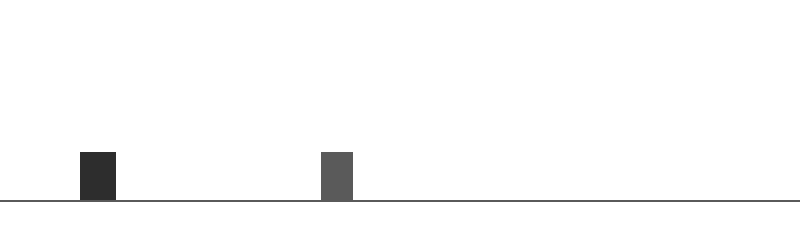

# Milestone 1 validation

Executed on 2026-09-20 in the project-local Python 3.10.13 virtual environment.
Installed versions include NumPy 2.2.6, Gymnasium 1.3.0, PyTorch 2.14.0,
Pygame 2.6.1 and pytest 9.1.1. The full installed-version snapshot is in
`validated-environment.txt`; it is a record of this environment, not a portable
CUDA installation lockfile. Automatic device selection returned CPU in this
execution context; actual accelerator execution was not validated.

## Executed checks

| Check | Result |
|---|---|
| `python -m pytest -q` | 18 passed |
| Gymnasium `check_env` | Passed; two warnings about intentionally unbounded raw observation space |
| `ruff check dino_rl scripts tests` | Passed |
| `ruff format --check dino_rl scripts tests` | Passed |
| `python -m pip check` | No broken requirements |
| Random CLI, 20 episodes, seed 42 | All completed through collisions, no runtime errors |
| Repeat of identical random CLI command | Identical episode records; wall time excluded |
| `SDL_VIDEODRIVER=dummy ... --episodes 1 --render --device cpu` | Completed; offscreen display path only |
| RGB frame inspection | 800×240 RGB image inspected; ground, Dino and obstacle visible |

The raw-observation warnings are not suppressed: numerical normalization is the
next milestone. An interactive desktop window has not been manually exercised.

## Random-policy measurements

Run with:

```bash
python scripts/play_simulator.py --episodes 20 --seed 42 \
  --output results/random_seed42.json
```

| Episodes | Mean score | Mean survival (simulated seconds) | Mean reward | Mean cleared |
|---:|---:|---:|---:|---:|
| 20 | 69.3905 | 2.2867 | 3.62 | 0 |

Full episode data and resolved configuration are preserved in
[random_seed42.json](random_seed42.json). Frequent random jumps tend to land near
the first obstacle in this configuration. This is an environment smoke baseline,
not a trained model or a complete future evaluation protocol. Timing measurements
exclude Python/import startup and should not be treated as a training benchmark.

## Default-world playability smoke check

A handwritten timing policy cleared 84–87 obstacles in each of ten episodes,
all reaching the 6,000-step limit (100 simulated seconds). This checks that the
default actions and geometry permit sustained survival; it is **not learning**
and does not establish that every possible obstacle sequence is solvable.
Records are in [heuristic_smoke.json](heuristic_smoke.json).

Reproduce this diagnostic from the installed project:

```python
from dino_rl.envs import DinoEnv

env = DinoEnv()
try:
    for seed in range(10):
        obs, _ = env.reset(seed=seed)
        while True:
            action = 2 if obs[7] == 2 else (1 if obs[3] / obs[0] < 0.30 else 0)
            obs, _, terminated, truncated, info = env.step(action)
            if terminated or truncated:
                print(seed, info["obstacles_cleared"], info["episode_steps"])
                break
finally:
    env.close()
```

## Simulator frame



There are no neural-network, training, checkpoint, vision preprocessing or Chrome
tests yet because those implementations are outside Milestone 1.
