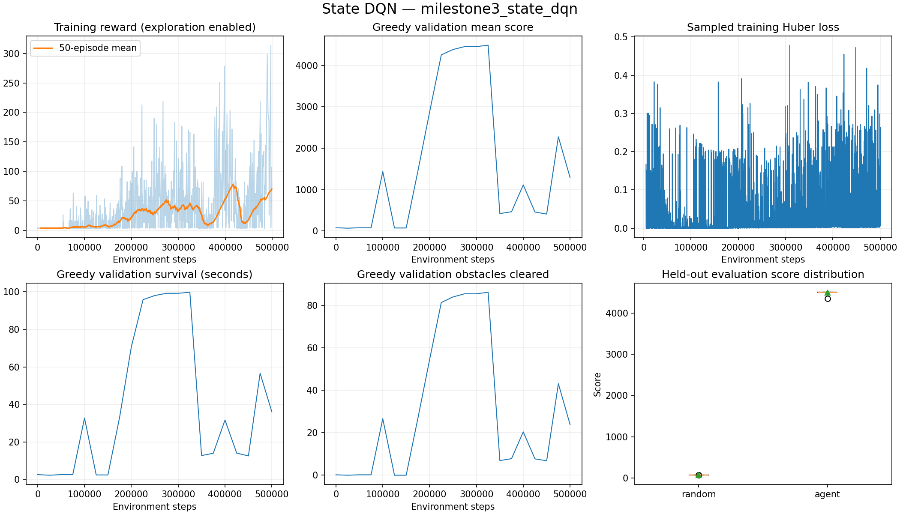
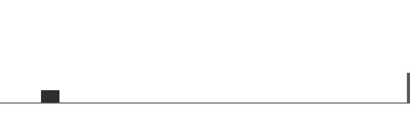

# Milestone 3 validation

Implemented and tested on 2026-09-23 with Python 3.10.13, PyTorch 2.14.0,
Gymnasium 1.3.0, TensorBoard 2.21.0 and CPU. No changes were made to simulator
physics, rewards or the original vanilla DQN hyperparameters for this experiment.

## Engineering verification

- 60 pytest tests passed. Two pre-existing warnings concern unbounded raw Gymnasium
  observation limits; model inputs still use fixed feature scaling.
- Ruff lint/format checks passed and `pip check` found no broken dependencies.
- Resume matched uninterrupted CPU training exactly, including online weights,
  target weights, Adam state, replay contents/order/RNG and counters. Tests cover
  partial episodes, replay wraparound, time limits, obstacle RNG and collision resets.
- Failed checkpoint writes preserved the previous file; a simulated interruption
  retained the last complete periodic checkpoint.
- Checkpoints loaded with `torch.load(..., weights_only=True)`; incompatible
  versions and changed training dynamics were rejected.
- Evaluation left network weights, exploration RNG, update counts and prior
  network mode unchanged. Random and learned policies used matched world seeds.
- TensorBoard event contents were verified through the event reader. The actual
  local browser dashboard displayed training/evaluation charts during training.
- The actual CLI resumed the 25,000-step snapshot to 25,010, retaining replay,
  optimizer updates, exploration schedule and its unfinished episode. Evidence
  remains in `runs/milestone3_resume_smoke`.

## Reproduce the experiment

From the project root, activate the virtual environment and run:

```bash
python scripts/train.py --steps 500000 --device cpu --seed 42 \
  --output-dir runs/milestone3_state_dqn

python scripts/evaluate.py --checkpoint runs/milestone3_state_dqn/checkpoints/best.pt \
  --episodes 30 --seed 20000 --device cpu --compare-random \
  --output results/milestone3_heldout.json

python scripts/plot_training.py --run runs/milestone3_state_dqn \
  --comparison results/milestone3_heldout.json --output docs/milestone3-training.png

python scripts/record_gameplay.py --checkpoint runs/milestone3_state_dqn/checkpoints/best.pt \
  --seed 20000 --seconds 12 --output docs/milestone3-gameplay.gif
```

Existing outputs are intentionally protected: use new output names to repeat a
training run, evaluation or recording. The full checkpoint files and TensorBoard
events remain locally under the ignored `runs/` directory. Small evidence files
and exported graphics are kept under `docs/` for portfolio review.

## Evaluation protocol

One training seed (42), 500,000 environment steps, original configuration.
Checkpoint selection uses the highest mean score over ten fixed validation seeds
10,000–10,009, evaluated initially, every 25,000 steps, and at completion. Ties keep
the earlier model. The held-out comparison uses 30 previously unused seeds
20,000–20,029, epsilon zero, no optimizer steps, and the same world seeds for a
uniform random policy. This is one trained model evaluated repeatedly, not a
multi-training-seed robustness study.

Score is simulated distance / 10. Survival and episode duration mean simulated
time, not machine execution time. The 6,000-step/100-second limit censors survival;
reaching it is a truncation, not proof of indefinite play. Standard deviation is
the population standard deviation of the 30 episode scores.

Training performance may fluctuate even as learning progresses. `best.pt` and
`latest.pt` intentionally have different meanings; the held-out test assesses
the validation-selected model, not whichever state was saved last.

## Measured results

Training completed 500,000 environment steps, 495,001 gradient updates, 1,911
completed exploratory episodes and 100 target synchronizations. Training-loop
elapsed time was 290.23 seconds, including evaluations/checkpoint writes but
excluding setup/imports; this is not a general hardware benchmark.

The selected best checkpoint is from **step 325,000**, with validation mean score
4487.02. The final step-500,000 model's validation score was only 1289.90.
The final model was not substituted for the validation-selected model.

| Held-out measure (30 episodes) | Best state DQN | Uniform random |
|---|---:|---:|
| Mean score | 4495.22 | 68.84 |
| Maximum score | 4500.25 | 70.31 |
| Score standard deviation | 27.11 | 0.29 |
| Mean simulated survival | 99.92 s | 2.27 s |
| Mean reward | 685.62 | 3.51 |
| Mean obstacles cleared | 86.47 | 0.00 |
| Reached 100-second limit | 29/30 | 0/30 |

The DQN outscored the matched random policy in all 30 games. This satisfies the
Milestone 3 objective of meaningful obstacle avoidance beyond random play.
It does not establish indefinite survival, learning consistency across training
seeds, or transfer to a browser game.

Artifacts:

- [Held-out records and checkpoint SHA-256](milestone3-results/heldout.json)
- [Resolved experiment configuration](milestone3-results/config.json)
- [Training summary](milestone3-results/summary.json)
- [Validation trajectory](milestone3-results/evaluations.csv)
- [Exploratory training episodes](milestone3-results/episodes.csv)
- [Sampled optimizer metrics](milestone3-results/updates.csv)
- [Installed package snapshot](milestone3-environment.txt)





The clip uses the first held-out seed rather than selecting a visually successful
episode. It covers 720 steps/12 seconds and seven cleared obstacles; it is a visual
example, not the source of the aggregate performance claims.

## Monitoring and playback

```bash
tensorboard --logdir runs --host 127.0.0.1 --port 6006
python scripts/evaluate.py --checkpoint runs/milestone3_state_dqn/checkpoints/best.pt \
  --episodes 3 --render --output results/watch.json
```

Open http://127.0.0.1:6006. TensorBoard needs no account or TensorFlow installation.
Its "TensorFlow installation not found" notice is expected; scalar charts work.
The current session's dashboard is focused on `runs/milestone3_state_dqn`.

Checkpoint and logging implementation references:
[PyTorch save/load](https://docs.pytorch.org/tutorials/beginner/saving_loading_models),
[restricted checkpoint loading](https://docs.pytorch.org/docs/stable/generated/torch.load),
[TensorBoard integration](https://docs.pytorch.org/tutorials/recipes/recipes/tensorboard_with_pytorch.html).

MPS/CUDA training and cross-device resume are supported in code but were not
executed here. Real Chrome transfer and vision-based observations remain untested
and unimplemented, respectively. Rendering uses the existing rectangular clone.
