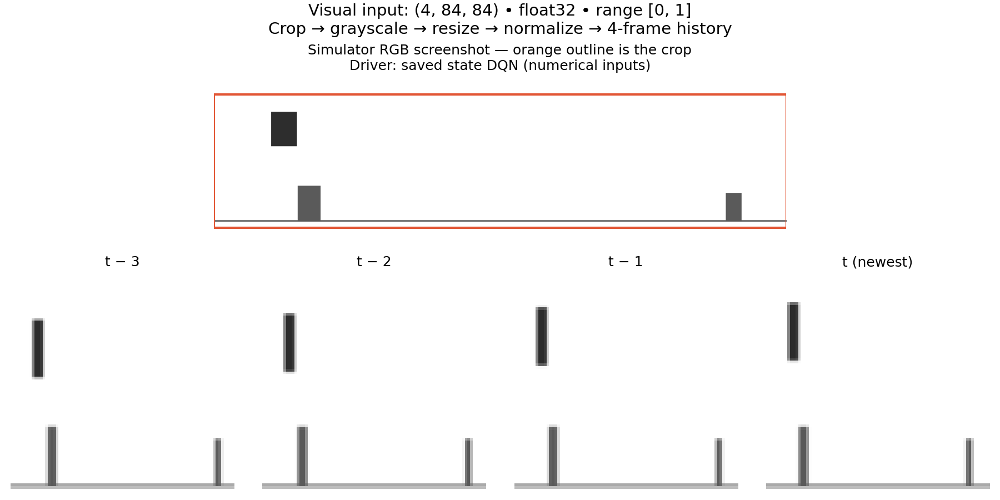

# Milestone 4: visual observation pipeline

Completed on 2026-09-24 using Python 3.10.13, Pillow 12.3.0, NumPy 2.2.6,
Gymnasium 1.3.0 and PyTorch 2.14.0. This milestone prepares image observations;
it does not add a CNN, change the state agent, or claim visual-policy performance.

## Implemented

- `ImageConfig`: strict crop/resolution/stack configuration, plus a YAML profile.
  Existing numerical checkpoints without an `image` section retain compatibility.
- `ImagePreprocessor`: validates uint8 RGB, crops, converts to grayscale luminance,
  bilinearly resizes, and optionally normalizes. It is independent of the simulator.
- `FrameStack`: four consecutive frames, oldest first, uint8 internal storage,
  fresh contiguous float32 observations. Reset repeats the first frame and removes
  all prior episode history.
- `ImageObservationWrapper`: existing simulator screenshots become bounded
  `(4, 84, 84)` observations. Rewards, flags, actions and physics are unchanged;
  no frame skip/action repeat is added. The terminal frame is preserved.
- `preview_observations.py`: inspectable RGB/crop/resized PNGs, a numerical `.npy`
  stack, metadata and a labeled visual preview. Optional checkpoint play still uses
  the saved numerical agent, never an untrained visual policy.

The existing NumPy RGB renderer supplies screenshots without Pygame or a desktop
window. Pillow is now a declared direct dependency instead of only being installed
transitively via Matplotlib.

## Checks run

| Check | Result |
|---|---|
| Full `pytest -q` suite | 86 passed |
| Ruff lint and formatting | Passed |
| `pip check` | No broken requirements |
| Gymnasium API check on visual wrapper | Passed |
| Numerical versus visual environment, 500 identical random actions | Identical rewards, endings and info across resets |
| Random-driver preview, seed 7, 500 steps | Completed through four episodes |
| Existing state checkpoint preview, seed 42, 135 steps | Loaded and played successfully; no training |
| Preview layout inspection | Crop, Dino, obstacles and four temporally changing frames visible |

The two existing warnings concern the raw numerical environment's unbounded Box.
The visual space is bounded `[0, 1]`. The expected Gymnasium wrapper-check advisory
is explicitly asserted by its test.

Tests also cover pure red/green/blue luminance, exclusion of pixels outside the
crop, invalid channels/dtype/crops, output shapes, bilinear edge values, stack
order, no input/output aliasing, reset padding, terminal/truncated frames,
configurable dimensions, legacy config loading and PyTorch batch shape.

## Actual preview evidence

Reproduce in a new output directory:

```bash
python scripts/preview_observations.py \
  --checkpoint runs/milestone3_state_dqn/checkpoints/best.pt \
  --seed 42 --steps 135 --output-dir results/milestone4_preview
```

The preserved preview uses the unchanged Milestone 3 best checkpoint, whose SHA-256
is recorded in [metadata.json](milestone4-preview/metadata.json).

| Stage | Verified output |
|---|---|
| Source RGB | `(240, 800, 3)`, uint8 |
| Crop `(0, 24, 800, 210)` + grayscale | `(186, 800)`, uint8 |
| Resized frame | `(84, 84)`, uint8 |
| Four-frame model observation | `(4, 84, 84)`, float32 |
| PyTorch batch layout | `(1, 4, 84, 84)` |
| Actual pixel range in this snapshot | 0.17647059–1.0, inside the declared [0, 1] bounds |
| Changed pixels between adjacent frames | 244, 231, 226 |
| Simulation time between frames | 1/60 second |
| Oldest-to-newest temporal span | 3/60 = 0.05 seconds |

Artifacts: [RGB](milestone4-preview/rgb.png),
[cropped grayscale](milestone4-preview/crop_grayscale.png),
[84×84 frame](milestone4-preview/frame.png),
[normalized stack](milestone4-preview/stack.npy).



## Limits and next milestone

The default crop covers the default jump arc, ground and full horizontal scene.
Changed physics or capture geometry may require a different crop. The resize
deliberately does not preserve aspect ratio, and narrow objects become only a few
pixels wide. Successful CNN learning must be measured, not inferred from this
preview. Color input must be RGB; a future BGRA/BGR capture adapter is separate.

The stack stores 28,224 bytes internally and exposes a 112,896-byte float32 array.
Naively duplicating current/next float32 stacks over 100,000 transitions would
require 22,579,200,000 bytes (~21.03 GiB) before overhead. Milestone 5 must use
memory-conscious visual replay rather than extending the state buffer unchanged.

Milestone 5 will add the CNN and image-based DQN training, then compare it against
the existing state agent. Hybrid models, Double DQN and Chrome remain later work.

Implementation references: [Pillow image conversion/resizing](https://pillow.readthedocs.io/en/stable/reference/Image.html)
and [Gymnasium observation wrappers](https://gymnasium.farama.org/api/wrappers/observation_wrappers/).
