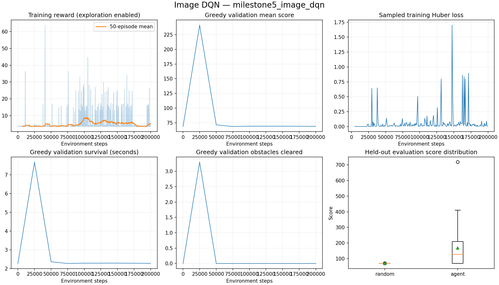
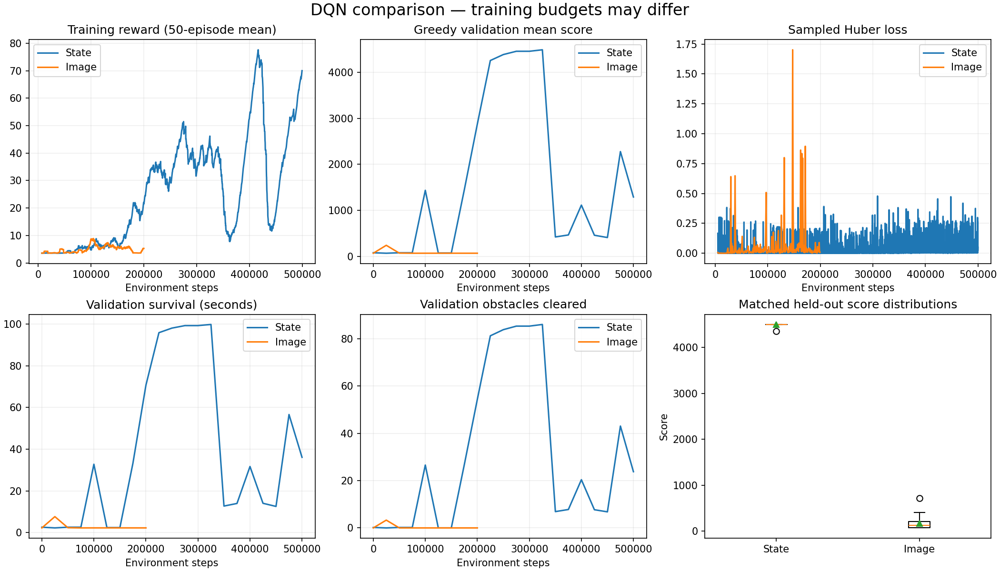
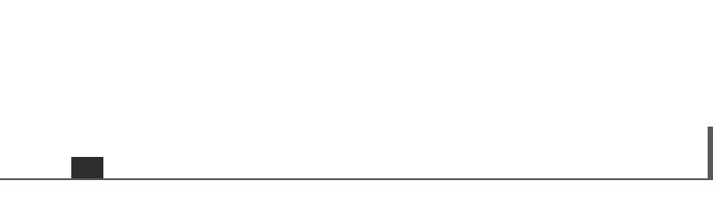

# Milestone 5: image DQN

Implemented on 2026-09-24; final report completed on 2026-09-25. The simulator now supports a separate CNN agent that
learns exclusively from four grayscale frames. Numerical DQN remains available,
and existing state checkpoints still load. Hybrid and Double DQN are later work.

## Implementation

- Atari-style CNN: 32 filters (8/4), 64 (4/2), 64 (3/1), ReLU after each;
  flatten 3136 → Linear(256) → ReLU → three Q-values.
- Shared vanilla DQN updates, epsilon-greedy selection, Huber loss, Adam,
  frozen target network and hard synchronization. Model/environment constructors
  select numerical or image mode for training, evaluation and playback.
- Five owned uint8 frames per replay transition reconstruct both four-frame
  stacks without crossing episodes or referring to overwritten ring-buffer slots.
  20,000 entries allocate 705,860,000 bytes (673 MiB). A configurable limit rejects
  excessive allocations before allocation. Sampling normalizes only on model input.
- Version-2 atomic checkpoints preserve image history, replay, simulator, optimizer
  and random generators. Version-1 numerical checkpoints remain compatible.
  A full checkpoint is about 720 MB; the image profile retains two periodic files
  plus best/latest. Temporary atomic writes and serialization copies need extra space.
- The human viewer and headless image capture share rendering code. Observation
  capture does not add a second display refresh or sleep.
- Comparison exports match simulator/reward settings and ordered evaluation seeds
  before plotting reward, score, loss, survival, obstacles and score distributions.
  Training budgets and hyperparameters are included rather than assumed equal.

## Engineering checks

- **96 pytest tests passed**, with the same two existing warnings about the raw
  numerical observation space's infinite limits. Ruff lint/format checks passed;
  `pip check` found no broken requirements.
- CNN batch output shape and finite weight updates; uint8 normalization; no target
  gradients; replay ownership, shifting, wraparound, memory guards and RNG restore.
- Exact CPU visual resume matched uninterrupted online/target weights, counters,
  observations and sampled replay across a partial episode and replay wraparound.
  Changed observation mode was rejected; periodic retention kept the requested count.
- Evaluation received only image tensors with epsilon zero and performed no updates.
  Comparison tests rejected different game physics, reward settings and evaluation seeds.
- Actual CLI resume: step 50,000 → 50,008, with 20,000 replay transitions retained and
  update count 5,626 → 5,627. Logs are in `runs/milestone5_resume_smoke`.
- Offscreen Pygame human-image smoke check: reset and all three actions returned
  `(4,84,84)` observations, with exactly five simulator ticks after five steps.
  This is an offscreen check, not a newly verified native desktop-window session.
- The actual local TensorBoard browser displayed both state and image curves.
  It is focused on validation score, survival and obstacle count at localhost:6006.
  Event-reader checks confirmed reward, loss, Q-values, epsilon, replay size and
  validation score events were present and advancing.
- Re-evaluated the original state checkpoint through the shared model/environment
  factory: all 30 learned-policy and 30 random-policy episode records were identical
  to the original Milestone 3 report, including its checkpoint hash.

## Experiment protocol

Reproduce the recorded bounded run:

```bash
python scripts/train.py --config configs/experiments/image_dqn_milestone5.yaml \
  --output-dir runs/milestone5_image_dqn
python scripts/evaluate.py --checkpoint runs/milestone5_image_dqn/checkpoints/best.pt \
  --episodes 30 --seed 20000 --device cpu --compare-random \
  --output results/milestone5_heldout.json
python scripts/compare_experiments.py \
  --reports results/milestone3_heldout.json results/milestone5_heldout.json \
  --labels State Image --runs runs/milestone3_state_dqn runs/milestone5_image_dqn \
  --output-dir results/state_image_comparison
```

Use fresh output paths when repeating. The image experiment uses one training seed
(42), CPU, 200,000 steps, batch 16, updates every eight environment steps, 20,000
replay entries and epsilon decay over 100,000 steps. It retains the original
physics/rewards, 60 Hz one-tick action timing, 5,000-step warm-up and target sync,
learning rate 1e-4 and gamma 0.99. No action repetition, frame skipping, reward
shaping or access to numerical observations is introduced.

Checkpoints are selected using ten validation seeds 10,000–10,009, evaluated at
step zero, every 25,000 steps and completion. The final held-out evaluation uses
30 seeds 20,000–20,029, matched to the existing state and random results. No tuning
is based on held-out scores. Survival is capped at 100 simulated seconds.

The state baseline used 500,000 steps, batch 64, updates every step, replay 100,000
and epsilon decay 200,000. **This is a practical comparison of these trained runs,
not a controlled estimate of architecture advantage or sample efficiency.**
Episode variation is not variation over independent training seeds.

The default `configs/image_dqn.yaml` provides a longer starting profile: one million
steps, batch 32, updates every four steps and epsilon decay 200,000. That full profile
has not been run here. The bounded experiment is explicitly separate.

## Device microbenchmark

On this M1 Pro, random uint8 batch-32 CNN updates and individual greedy actions
were timed after warm-up (40 updates and 100 actions). CPU used one PyTorch thread.
MPS was verified by actual successful optimizer updates outside the sandbox.

| Device | Update | Single action |
|---|---:|---:|
| CPU | 47.60 ms | 0.34 ms |
| MPS | 8.91 ms | 5.92 ms |

These isolated timings exclude environment and checkpoint costs. They do not
establish an end-to-end speed winner; the actual training experiment uses CPU.
CUDA and cross-device resume were not exercised. Exact resume is tested only on CPU.

## Limitations

This clone uses rectangles; successful simulator play does not establish real Chrome
transfer. The wide crop compresses narrow obstacles to a few pixels, and consecutive
frames cover only 50 ms of motion. Crop, resolution, temporal spacing and hyperparameter
choices have not been systematically compared. The first experiment has a smaller
training/update budget than the state baseline, and vanilla DQN may regress during
training. Keep best-validation selection and report held-out measurements honestly.


## Measured results

The run completed 200,000 environment steps, 24,376 gradient updates, 1,349 completed
exploratory episodes and 40 target synchronizations. Training-loop elapsed time was
786.48 seconds (13.11 minutes), including validation and checkpoint writes, excluding
setup/imports. This is a run measurement, not a general hardware benchmark.

The validation-selected checkpoint is **step 25,000**, with mean validation score
241.18 and 3.3 obstacles. The final step-200,000 model scored only 69.08 in validation.
We evaluated the selected model, not the latest model, on the held-out seeds.

| Held-out measure (30 episodes each) | State DQN | Image DQN | Random |
|---|---:|---:|---:|
| Mean score | 4495.22 | 168.33 | 68.84 |
| Maximum score | 4500.25 | 718.04 | 70.31 |
| Score standard deviation | 27.11 | 135.14 | 0.29 |
| Mean simulated survival | 99.92 s | 5.38 s | 2.27 s |
| Mean reward | 685.62 | 24.16 | 3.51 |
| Mean obstacles cleared | 86.47 | 1.97 | 0.00 |
| Reached 100-second cap | 29/30 | 0/30 | 0/30 |

The image agent cleared at least one obstacle in 18/30 games and outscored the
matched random policy in 19/30. It learned limited avoidance beyond random, but is
inconsistent and much weaker than the state model in these experiments. Later
training did not preserve the early improvement. The CNN implementation and
comparison are complete; this is not a claim of a strong visual policy. More training
alone is not guaranteed to fix the regression. Future experiments should vary one
factor at a time and select models on validation seeds, using fresh held-out seeds
if tuning is informed by this report.

The recorded GIF uses the first held-out seed (20,000), not a cherry-picked success:
it clears two obstacles and crashes at step 310, 5.17 simulated seconds. The requested
12-second recording naturally stops at game over. The aggregate scores come from
all 30 episodes, not from this clip.

Artifacts:

- [Configuration](milestone5-results/config.json) and [summary](milestone5-results/summary.json)
- [Held-out episodes and checkpoint SHA-256](milestone5-results/heldout.json)
- [Validation trajectory](milestone5-results/evaluations.csv)
- [Exploratory episodes](milestone5-results/episodes.csv) and [updates](milestone5-results/updates.csv)
- [Comparison CSV](milestone5-results/comparison.csv) and [provenance JSON](milestone5-results/comparison.json)
- [State regression check](milestone5-results/state-regression.json)
- [Device timings](milestone5-results/device-benchmark.json) and [package snapshot](milestone5-environment.txt)

Full checkpoints and TensorBoard events remain local in ignored `runs/` directories.
The selected image checkpoint is `runs/milestone5_image_dqn/checkpoints/best.pt`.






