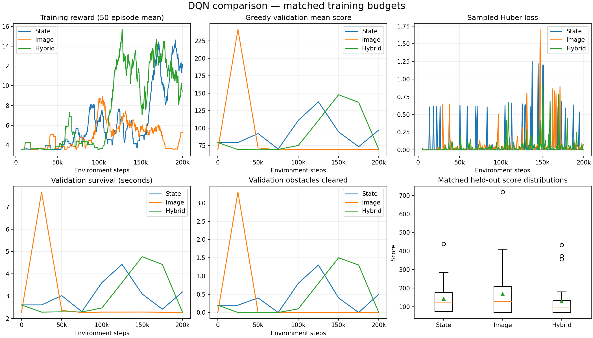
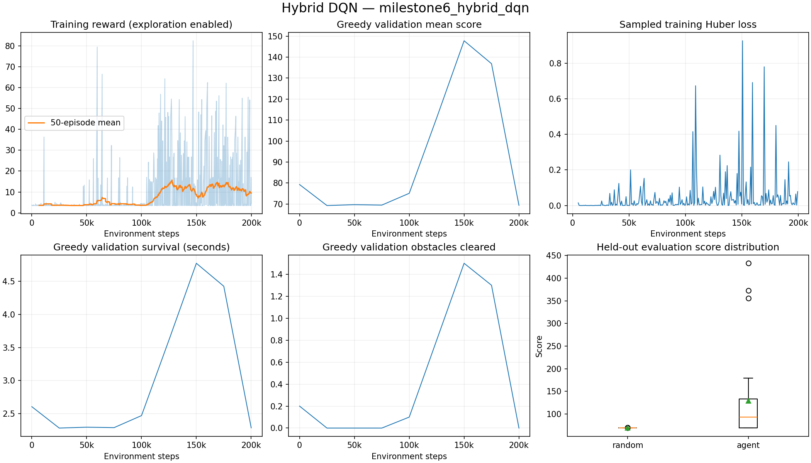
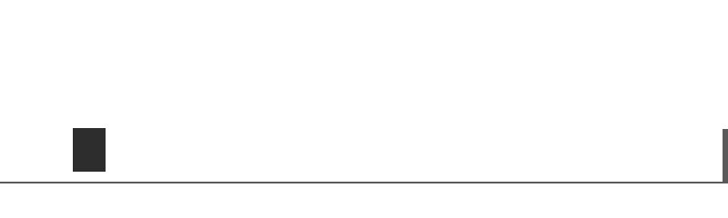

# Milestone 6: hybrid DQN

Implemented on 2026-09-25. The hybrid agent combines synchronized screenshots and
numerical features, using the existing vanilla DQN training system. Double DQN
and real Chrome integration remain later milestones.

## Architecture and data contract

The image branch shares the Atari convolutional architecture used in Milestone 5:
Conv32 (8/4), Conv64 (4/2), Conv64 (3/1), with ReLU, then flatten 3136 → Linear256
→ ReLU. The numerical branch is ten normalized features → Linear64 → ReLU.
Concatenation produces 320 features, then Linear256 → ReLU → three action values.
Both branches train from scratch together. No prior checkpoint weights are imported.

`HybridObservationWrapper` returns `{"image": array, "state": array}`. Image shape is
(4,84,84), float32 [0,1]; numerical shape is (10,), float32, with exactly the same
normalization as the state agent. Both describe the current simulator tick. Numerical
normalization occurs once inside this wrapper. There is no extra physics step,
frame skip, action repetition or reward shaping.

`HybridReplayBuffer` extends compact visual replay using one ring and one set of
sampled indices. Each slot owns five uint8 frames and two ten-feature float32
vectors. Frames reconstruct the current/next stacks; true terminal observations
are stored before reset. Crash transitions stop bootstrapping; time-limit transitions
retain their final inputs and bootstrap normally. At capacity 20,000, array storage
is 707,460,000 bytes (674.69 MiB). The allocation guard includes the numerical arrays.

Version-2 checkpoints retain both replay modalities, image history, simulator,
optimizer, online/target networks and RNG states. Old numerical and image checkpoints
remain compatible. Observation modes cannot be changed during resume. Default
hybrid/image profiles retain the last two periodic snapshots plus best/latest.

## Checks performed

- **107 pytest tests passed.** Five Gymnasium warnings concern unbounded numerical
  Box limits and intentionally checking a wrapped environment; no tests failed.
  Ruff lint and formatting checks passed; `pip check` found no broken requirements.
- Across 500 identical actions, hybrid observations matched separately driven image
  and normalized state observations, with identical rewards, flags and game info.
  Reset and terminal observations preserve both modalities.
- Replay insertion, wraparound, copying and checkpoint restore preserve alignment
  between images, state vectors, actions, rewards and terminal flags. A memory test
  verifies that adding state arrays can exceed the guard even when frames alone fit.
- Both model branches receive nonzero input gradients and update their parameters;
  the target remains frozen until explicit synchronization. Pixel conversion leaves
  already-normalized numerical inputs unchanged.
- Exact CPU resume matches uninterrupted weights, target, Adam state, counters,
  observations and replay samples across a partial episode and replay wraparound.
- Actual CLI resume continued a full-size checkpoint from step 50,000 to 50,008,
  retaining 20,000 replay entries and advancing updates from 5,626 to 5,627.
  Evidence: `runs/milestone6_resume_smoke`.
- Greedy hybrid evaluation uses both declared inputs with epsilon zero and leaves
  weights, exploration RNG and update counts unchanged.
- A fresh-process import test prevents a discovered circular import from returning.
  The standalone evaluation CLI works after correcting the package export.
- The old state and image checkpoints were each re-evaluated on 30 learned-policy
  and 30 random-policy episodes: every episode record and checkpoint hash matched
  their original reports exactly.
- Offscreen Pygame human-viewer smoke: all three actions returned the expected Dict
  shapes; five steps advanced exactly five ticks. This does not claim a new native
  desktop-window acceptance check.
- Actual MPS smoke: an eight-transition hybrid batch completed an optimizer update,
  target sync and greedy action on `mps:0`, with finite metrics. Full training uses CPU;
  CUDA and cross-device resume have not been tested in this milestone.
- The actual local TensorBoard browser displayed all three runs and their metrics.

## Reproduce

The default `configs/hybrid_dqn.yaml` is a million-step starting profile, matching
the default image profile; that full profile has not been run. The bounded experiment
uses the separate config below.
Use new output paths if reproducing; existing run directories are protected.

```bash
python scripts/train.py --observation hybrid \
  --config configs/experiments/hybrid_dqn_milestone6.yaml \
  --output-dir runs/milestone6_hybrid_dqn
python scripts/train.py --config configs/experiments/state_dqn_milestone6.yaml \
  --output-dir runs/milestone6_state_matched

python scripts/evaluate.py --checkpoint runs/milestone6_hybrid_dqn/checkpoints/best.pt \
  --episodes 30 --seed 20000 --device cpu --compare-random \
  --output results/milestone6_heldout.json
python scripts/evaluate.py --checkpoint runs/milestone6_state_matched/checkpoints/best.pt \
  --episodes 30 --seed 20000 --device cpu --compare-random \
  --output results/milestone6_state_matched_heldout.json

python scripts/compare_experiments.py \
  --reports results/milestone6_state_matched_heldout.json \
    results/milestone5_heldout.json results/milestone6_heldout.json \
  --labels State Image Hybrid \
  --runs runs/milestone6_state_matched runs/milestone5_image_dqn runs/milestone6_hybrid_dqn \
  --require-matched-training --output-dir results/milestone6_comparison
```

The existing image result is reused, with its checkpoint/configuration verified,
not retrained or selected using the hybrid results. All three comparison runs use:

| Setting | Value |
|---|---:|
| Training seed | 42 |
| Environment steps | 200,000 |
| Gradient updates | 24,376 |
| Batch size | 16 |
| Replay capacity | 20,000 |
| Learning starts | 5,000 steps |
| Update frequency | Every 8 steps |
| Epsilon | 1.0 → 0.05 over 100,000 steps |
| Target synchronization | Every 5,000 steps |
| Adam learning rate | 0.0001 |
| Gamma | 0.99 |
| Physics / actions / rewards | Original defaults |
| Device / PyTorch threads | CPU / 1 |

Validation uses ten seeds 10,000–10,009 at step zero, every 25,000 steps and at the
end. The highest mean validation score selects `best.pt`, with earlier models kept
on ties. The comparison uses the existing 30 held-out seeds 20,000–20,029, epsilon
zero, no updates and matched random actions/world seeds. These evaluation seeds
were already reported in previous milestones; no hybrid tuning or checkpoint
selection is based on their outcomes. Survival is capped at 100 simulated seconds.

The original Milestone 3 state agent remains a **separate longer-trained reference**:
500,000 steps, 495,001 updates, batch 64, replay 100,000 and slower epsilon decay.
It is not substituted for the new matched-budget state agent in the primary comparison.

The strict comparison flag rejects different training settings (apart from network
widths), unfinished budgets, unequal update counts, different game settings or
unmatched evaluation seeds. Matched settings do not imply equal wall time, model
capacity or initialization tensors. These are still only one training seed per model,
not evidence of a generally superior architecture.

## Monitoring and limitations

```bash
tensorboard --logdir_spec \
state_matched:runs/milestone6_state_matched/tensorboard,image:runs/milestone5_image_dqn/tensorboard,hybrid:runs/milestone6_hybrid_dqn/tensorboard \
  --host 127.0.0.1 --port 6007
python scripts/record_gameplay.py \
  --checkpoint runs/milestone6_hybrid_dqn/checkpoints/best.pt \
  --seed 20000 --seconds 12 --output results/hybrid_gameplay.gif
```

The local dashboard is at http://127.0.0.1:6007 while the server is running.
Human playback is also available with the existing evaluation `--render` flag.

Hybrid inference requires numerical features as well as images. It is not a
screenshot-only Chrome agent. Actual Chrome integration will need an appropriate
state adapter or the image-only policy. The clone still uses rectangular graphics;
none of these results establish simulator-to-browser transfer. A branch-gradient
test establishes that both branches can learn, not that both are necessary to a
trained policy; no input-ablation or multiple-training-seed study has been run.


## Measured results

The hybrid run completed **200,000 environment steps and 24,376 updates**, with
1,203 completed exploratory episodes and 40 target synchronizations.
Training-loop elapsed time was 874.46 seconds
(14.57 minutes), including validation/checkpoint writes and
concurrent local verification work. It is not a controlled throughput benchmark.
The matched numerical run took 24.41 seconds; the earlier image run took 786.48 seconds.

The selected hybrid checkpoint is **step 150,000**, with validation
mean score 147.79. The final model's validation score was
69.39. The selected state checkpoint is step
125,000; the image checkpoint is step 25,000.

| Measure (30 episodes) | State | Image | Hybrid | Random |
|---|---:|---:|---:|---:|
| Mean score | 142.02 | 168.33 | 129.14 | 68.84 |
| Maximum score | 438.62 | 718.04 | 432.94 | 70.31 |
| Score standard deviation | 84.25 | 135.14 | 93.89 | 0.29 |
| Mean survival (seconds) | 4.59 | 5.38 | 4.17 | 2.27 |
| Mean reward | 18.79 | 24.16 | 16.05 | 3.51 |
| Mean obstacles cleared | 1.33 | 1.97 | 1.10 | 0.00 |
| Reached 100-second cap | 0/30 | 0/30 | 0/30 | 0/30 |

Hybrid cleared at least one obstacle in **15/30 games** and outscored its matched
random policy in **15/30 games**. Its weights learned during training, but these
measurements remain limited to one training seed and this simulator. Its mean score and survival were lower than both single-input agents in this run.
Combining two inputs is not a guarantee of stronger gameplay, nor does this experiment establish
that both inputs are necessary to its learned policy.

The historical state checkpoint still averages **4495.22 score and 99.92 seconds**.
That result used 495,001 gradient updates, versus 24,376 in each matched experiment,
plus different batch size, replay capacity and exploration decay. Its result is
unchanged by this milestone and remains available in the original run directory.
Do not mistake the newly trained smaller-budget state result for a regression in
that saved model. This comparison illustrates why training budgets must be visible.

Artifacts:

- [Hybrid configuration](milestone6-results/hybrid/config.json), [summary](milestone6-results/hybrid/summary.json), [held-out episodes/hash](milestone6-results/hybrid/heldout.json)
- [Hybrid validation trajectory](milestone6-results/hybrid/evaluations.csv), [training episodes](milestone6-results/hybrid/episodes.csv), [sampled updates](milestone6-results/hybrid/updates.csv)
- [Matched state configuration](milestone6-results/state/config.json), [summary](milestone6-results/state/summary.json), [held-out episodes/hash](milestone6-results/state/heldout.json)
- [Reused image records](milestone5-results/heldout.json)
- [Comparison CSV](milestone6-results/comparison.csv), [comparison provenance](milestone6-results/comparison.json)
- [Unchanged previous-policy verification](milestone6-results/regression.json)
- [MPS check](milestone6-results/mps-smoke.json), [CLI resume](milestone6-results/resume-smoke.json), [TensorBoard event check](milestone6-results/tensorboard-check.json)
- [Package snapshot](milestone6-environment.txt)

Full checkpoints remain local under ignored `runs/` directories. The selected hybrid
checkpoint is `runs/milestone6_hybrid_dqn/checkpoints/best.pt`.





The GIF uses the **first** held-out seed, 20,000, for up to 12 simulated seconds,
stopping early on game over. It is not selected for success; scores above come from
all 30 episodes.


