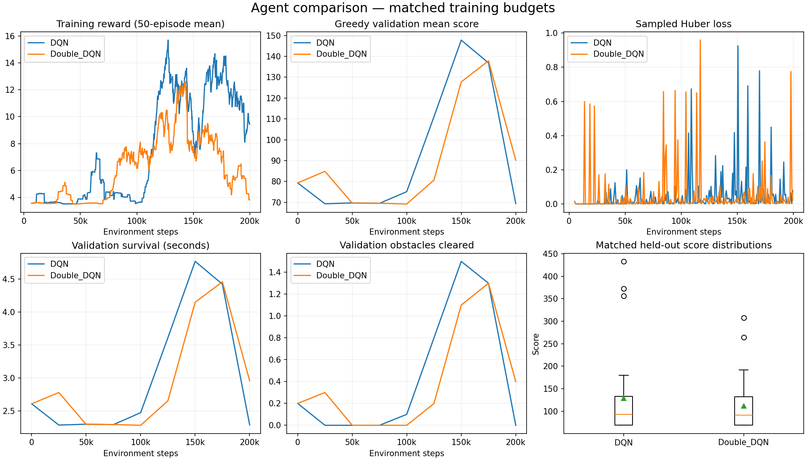
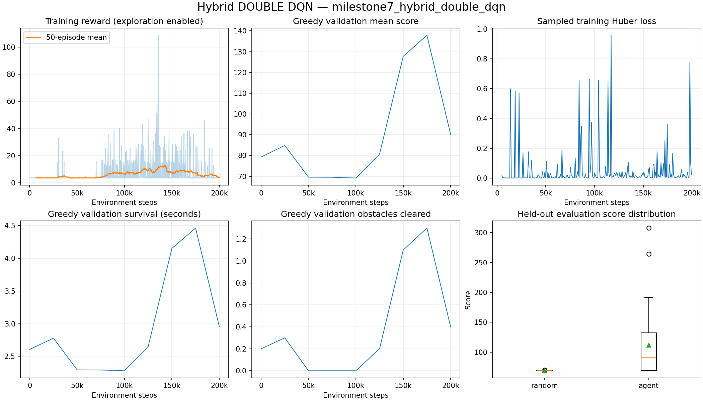
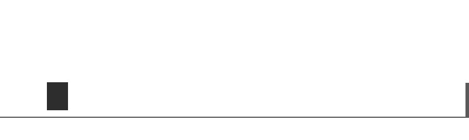

# Milestone 7: Double DQN

Implemented on 2026-09-25. Double DQN is selectable for state, image and hybrid
observations. This milestone compares hybrid Double DQN with the existing hybrid
DQN under the same architecture and training settings. Chrome integration remains
Milestone 8; no real-browser performance is claimed.

## What changes

`DoubleDQNAgent` inherits the existing update/exploration/checkpoint behavior and
only overrides the Bellman target calculation:

```python
best_actions = online(next_states).argmax(dim=1, keepdim=True)
next_values = target(next_states).gather(1, best_actions).squeeze(1)
targets = rewards + gamma * torch.where(terminated, 0.0, next_values)
```

Vanilla DQN instead uses `target(next_states).max(dim=1).values`. Both versions
compute targets without gradients, mask real crashes and bootstrap through time
limits from the actual final observation. Huber loss, Adam, replay, exploration,
network architectures and hard target synchronization are shared unchanged.

Double DQN separates action selection from value evaluation to address maximization
bias in estimated action values. This follows [van Hasselt, Guez and Silver's original
paper](https://arxiv.org/abs/1509.06461). It does not guarantee better gameplay, and
this experiment's game scores are not a direct measurement of value overestimation.

`Config.algorithm` defaults to `dqn`. Explicit CLI selection overrides the config;
omitting it preserves the config or checkpoint value. Checkpoints and experiment
metadata record the algorithm. Loading rejects mismatched algorithm metadata, and
resume rejects changing algorithms. Existing format-1/2 DQN files without the new
config field continue to default to DQN. Evaluation, plots and comparison exports
label the saved algorithm correctly.

## Verification

- **115 pytest tests passed**, including all earlier tests. The same five Gymnasium
  warnings concern infinite numerical observation limits and wrapper checking.
  Ruff lint/format checks passed; `pip check` found no broken requirements.
- Exact arithmetic tests make online and target networks disagree on the best
  action. Double DQN uses the online index and target value, not the target maximum
  or the online value. Tests cover batch indexing, terminal masking, tensor and
  hybrid Dict inputs, detached targets and equivalence immediately after sync.
- All three observation modes complete actual Double DQN training, greedy evaluation
  and exact CPU resume. Online/target weights, Adam state, counters, current inputs
  and replay samples match uninterrupted training after a partial episode and wraparound.
- CLI subprocess tests verify explicit algorithm override and resume without an
  algorithm flag. Invalid algorithms, changed algorithms and inconsistent checkpoint
  metadata are rejected. Greedy evaluation leaves weights/update counts unchanged.
- The comparison script rejects different observations or network widths with
  `--require-same-model`; `--require-matched-training` additionally checks settings,
  completed environment budgets and equal update counts. Algorithm names are retained.
- Both experiment configurations differ **only in algorithm**. Reconstructed initial
  network parameters match exactly, as do all ten initial validation episode records.
- Re-evaluating the original hybrid DQN reproduced all 30 agent and 30 random episode
  records exactly, including the same checkpoint hash.
- A full-size hybrid batch completed a Double DQN optimizer update, target sync and
  inference on the actual `mps:0` GPU with finite metrics. Full training uses CPU;
  CUDA and cross-device resume were not exercised.

## Reproduce and monitor

```bash
python scripts/train.py --config configs/experiments/double_dqn_milestone7.yaml \
  --algorithm double_dqn --output-dir runs/milestone7_hybrid_double_dqn
python scripts/evaluate.py \
  --checkpoint runs/milestone7_hybrid_double_dqn/checkpoints/best.pt \
  --episodes 30 --seed 20000 --device cpu --compare-random \
  --output results/milestone7_heldout.json
python scripts/compare_experiments.py \
  --reports results/milestone6_heldout.json results/milestone7_heldout.json \
  --labels DQN Double_DQN \
  --runs runs/milestone6_hybrid_dqn runs/milestone7_hybrid_double_dqn \
  --require-matched-training --require-same-model \
  --output-dir results/milestone7_comparison
```

Existing outputs are protected; use new paths when repeating. To choose another
observation use `--algorithm double_dqn --observation state|image|hybrid` with the
training CLI. Its default profile is selected by observation. `configs/double_dqn.yaml`
is a separate hybrid million-step starting profile; that longer profile has not
been trained here.

```bash
tensorboard --logdir_spec \
DQN:runs/milestone6_hybrid_dqn/tensorboard,Double_DQN:runs/milestone7_hybrid_double_dqn/tensorboard \
  --host 127.0.0.1 --port 6008
python scripts/record_gameplay.py \
  --checkpoint runs/milestone7_hybrid_double_dqn/checkpoints/best.pt \
  --seed 20000 --seconds 12 --output results/double_gameplay.gif
```

The actual local browser dashboard on http://127.0.0.1:6008 displays both runs.
Evaluation with `--render` uses the existing simulator viewer. Numerical inputs
are still required by a hybrid policy; it is not a screenshot-only Chrome agent.

## Protocol and interpretation

Both runs start from scratch with training seed 42, identical initial weights,
the same hybrid network, 200,000 environment steps, batch 16, replay capacity
20,000, warm-up 5,000, one update per eight steps, and 24,376 total updates.
Epsilon falls from 1.0 to 0.05 over 100,000 steps; target sync is every 5,000 steps,
gamma 0.99, Adam learning rate 1e-4, CPU with one PyTorch thread. Physics, rewards,
normalization, crops and timing are unchanged. The numerical branch is 10→64,
image features 256, concatenation 320, shared head 256→3.

Checkpoints are evaluated initially, every 25,000 steps and at completion on the
ten validation seeds 10,000–10,009. Highest validation mean score selects best.pt;
ties keep the earlier checkpoint. Final comparison uses the same thirty test
seeds 20,000–20,029, greedy actions, no learning and a matched uniform random policy.
Those test seeds have been reported in earlier milestones; no Double DQN tuning
or checkpoint selection is based on their outcomes. Survival is capped at 100 seconds.

The saved DQN result is reused with verified identity, not retrained or replaced
based on the Double DQN outcome. Equal starting weights and settings do not imply
identical replay data after the policies diverge, nor equal wall-clock compute:
Double DQN adds an online forward pass for every next-state batch. This is one
training seed per algorithm, not a multiple-seed robustness study. Differences in
mean score are observations about these runs, not proof of general superiority.


## Measured results

Double DQN completed 200,000 environment steps, **24,376 updates**, 40 target syncs
and 1,271 complete exploratory episodes. Its measured training-loop
runtime was 1071.52 seconds (17.86 minutes),
including evaluations/checkpoint writes and concurrent local checks. This is not
a controlled throughput benchmark. The earlier DQN run took 874.46 seconds.

The selected Double DQN checkpoint is **step 175,000**, with mean
validation score 137.86. The final model scored
90.21 on validation. The reused DQN checkpoint is
step 150,000. Each algorithm gets its own validation-selected model.

| Measure (30 episodes) | Hybrid DQN | Hybrid Double DQN | Random |
|---|---:|---:|---:|
| Mean score | 129.14 | 111.66 | 68.84 |
| Max score | 432.94 | 307.88 | 70.31 |
| Score standard deviation | 93.89 | 58.40 | 0.29 |
| Mean survival (seconds) | 4.17 | 3.64 | 2.27 |
| Mean reward | 16.05 | 12.50 | 3.51 |
| Mean obstacles cleared | 1.10 | 0.77 | 0.00 |
| Reached 100-second cap | 0/30 | 0/30 | 0/30 |

Double DQN's average score was **lower** in this run. It outscored DQN in
2/30 matched games, outscored random in 15/30, and cleared at least
one obstacle in 15/30. These are measurements from one training seed;
no statistically general algorithm advantage or value-bias reduction is established.
A larger/multiple-seed experiment would be needed for stronger claims.

The strongest historical state-only checkpoint still belongs to the longer
Milestone 3 experiment (4495.22 mean score, 99.92 seconds). It used different budgets
and hyperparameters, so it is not the algorithm-control baseline here.

The actual CLI resumed Double DQN step 50,000 → 50,008 without supplying an
algorithm flag, retaining 20,000 replay entries and advancing 5,626 → 5,627 updates.
The full-size replay, partial episode and algorithm identity were preserved.

Artifacts:

- [Configuration](milestone7-results/config.json), [summary](milestone7-results/summary.json), [held-out episodes and checkpoint hash](milestone7-results/heldout.json)
- [Validation](milestone7-results/evaluations.csv), [exploratory episodes](milestone7-results/episodes.csv), [sampled updates](milestone7-results/updates.csv)
- [Comparison CSV](milestone7-results/comparison.csv), [comparison provenance](milestone7-results/comparison.json)
- [DQN baseline records](milestone6-results/hybrid/heldout.json)
- [Matched initialization and regression verification](milestone7-results/protocol-check.json)
- [MPS check](milestone7-results/mps-smoke.json), [legacy checkpoint load](milestone7-results/legacy-load.json), [CLI resume](milestone7-results/resume-smoke.json), [TensorBoard events](milestone7-results/tensorboard-check.json)
- [Package snapshot](milestone7-environment.txt)

The full selected checkpoint remains local under ignored `runs/` at
`runs/milestone7_hybrid_double_dqn/checkpoints/best.pt`.





Gameplay uses the first held-out seed, 20,000, for at most 12 seconds, stopping
on game over. It is not selected for success, and it is not the source of the
30-episode aggregate measurements.


